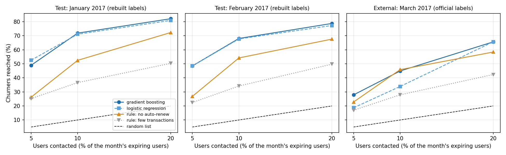
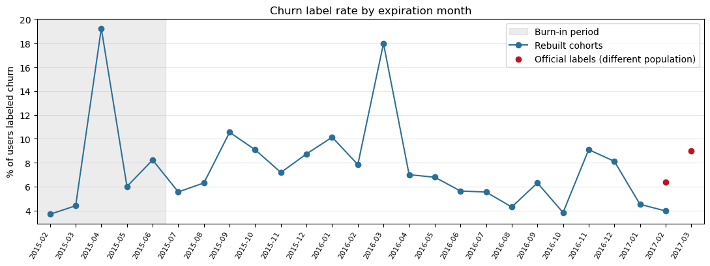

# KKBox Subscription Retention Analytics

An end-to-end retention case study on the [WSDM – KKBox Churn Prediction Challenge](https://www.kaggle.com/competitions/kkbox-churn-prediction-challenge) data: from a full-data quality audit to a defensible retention decision.

**Question:** Which behavioral signals appear before a KKBox subscriber churns, how early do they appear, and whom should be prioritized for intervention at a limited operational capacity?

## Key results

Full-data work on two data releases (about 444 million rows), with every figure reproducible from this repository.

- **Setup.** Churn labels were rebuilt from the transactions (98.4% agreement with the official February 2017 labels on shared users). Models see only what was known on the last day of the month before the expiry month, and are tested on later months.
- **Prioritization at limited capacity.** On the held-out months January and February 2017, contacting the 10% of expiring users ranked highest by gradient boosting reaches **71.9% and 68.1% of the churners**, against 52.5% and 54.2% for the best simple rule ("last transaction has auto-renew off") and 10% for a random list.
- **An honest caveat.** With the official labels the lead over that rule shrinks (60.8% against 52.6% in February) and in March 2017 it disappears at 10% capacity, because the official population includes 11.2% of users the model was not built for and the official labels seem to treat early renewals differently. The report quantifies each step.
- **Where the signal is.** Subscription records (auto-renew, number of transactions, recent cancellations) carry most of it; listening behavior has signal alone but adds only about 1 point on top.
- **Not done yet.** Intervention and experiment design (Stage F), the Snowflake and dashboard parts of Stage D, and the Databricks / PySpark version of the log features.

## Business scenario and decision

**Scenario (hypothetical).** A subscription music service sees renewals slip. Its retention team can contact only a fraction of the subscribers whose membership expires each month, with a renewal reminder, a payment fix, or an offer. The data is real (KKBox, 2017); the team, its capacity, and any costs are assumptions made for this case study.

**Decision.** Which expiring subscribers should the team contact first, how early can they be identified, and what action should be tested?

**Constraint: capacity K**, the share of each month's expiring subscribers the team can reach. The real capacity is unknown, so the analysis reports **K = 5%, 10%, and 20%**. For reference, in the March 2017 window (970,960 labeled users, 87,330 churn labels) a randomly chosen list reaches only K% of the churners: about 4,367 at 5%, 8,733 at 10%, and 17,466 at 20%. A useful model must beat this at the same K.

**Timeline.** Predict at the end of the month before the expiry month, act during the expiry month, and learn the outcome 30 days after expiry. The lead time therefore ranges from a day to about a month depending on the expiry day. The prediction cutoff is supported by a first check against the official labels (exploratory).

**Action to test (hypothesis).** Contact the top K% by predicted risk with a reminder or offer and keep a random holdout. Primary metric: renewal within 30 days of expiry. Guardrails: cost per retained subscriber, unsubscribe and complaint rates. Risk is not the same as responsiveness, so the first experiment can randomize within risk bands.

**How it will be judged.** Not by accuracy, which is about 91% for a list that predicts nobody churns, but by precision, recall, and lift at K on later months, plus calibration, with time-ordered validation.

**What it will not claim.** No causal lift and no financial return without observed experimental evidence; any scenario estimate states its assumptions. The prediction part (Stage E) is done; the experiment part (Stage F) is a design to be written, not a result.

## Status

Stages A (audit and definitions), B (PostgreSQL and SQL analysis) and E (prediction) are complete, Stage C (features) is built with DuckDB, and Stage D (dbt) is built and tested locally. Snowflake, the dashboard, the Databricks / PySpark version of the features, and Stage F (recommendations) are planned and not implemented yet.

| Stage | Work | Status |
|---|---|---|
| A. Audit and definitions | Audit of all source files, issue register, churn definition, label rebuild, monthly cohorts, cutoffs and feature windows | **Audit, label check and monthly cohorts complete**; prediction setup designed ([cutoffs, windows, splits](docs/prediction_design.md)) |
| B. Relational analytics | PostgreSQL, metric definitions, cohort retention and renewal SQL | **Complete: database built and reconciled with the audit** (staging and analytics schemas, [data model](docs/data_model.md)); [SQL analyses](reports/sql_analysis.md): label rates, plan mix, monthly churn, renewal gap, cohort retention |
| C. Behavioral features | `user_logs` to user-by-cutoff features | **Built with DuckDB** (63 columns, 21 months, four leakage checks passed, [notebook](notebooks/03_behavioral_features.ipynb)); Databricks / PySpark version planned |
| D. Serving and BI | Snowflake marts built with dbt, and a Power BI dashboard | **dbt project built and tested locally** on DuckDB (3 staging and 3 mart models, 38 data tests, [details](dbt/README.md)); Snowflake and the dashboard planned |
| E. Prediction | Baseline plus one stronger model with time-aware validation, top-k evaluation | **Evaluated** on three held-out months ([results](reports/model_results.md), [model card](docs/model_card.md)) |
| F. Recommendations | Intervention hypotheses, experiment design, final case study | Planned |

Each tool is introduced only when the work needs it. Used so far: Python and pandas for analysis, **DuckDB and Parquet** to audit and aggregate the 392-million-row listening logs on a laptop, **PostgreSQL** for relational modeling and SQL analysis, scikit-learn for the models, and **dbt** (on DuckDB) for tested marts. Planned: Databricks / PySpark for the large behavioral workload, Snowflake to serve the dbt marts, and a dashboard for retention monitoring.

## What the audit found

All figures are full-data results (every row), reproduced in [the audit notebook](notebooks/01_data_audit.ipynb) and summarized in [the audit report](reports/data_audit.md).

- **The "v2" files are not simple refreshes.** The v2 listening logs hold March 2017 only; the v2 transactions hold March plus 361,187 earlier rows that look like a supplement to v1. Neither release alone is a complete history, so the releases are combined through views with a `release` column and no row is dropped.
- **Two label windows, two churn rates.** The training labels cover different expiration months: 6.39% churn labels in `train.csv` and 8.99% in `train_v2.csv`. They are never pooled, and 881,701 users appear in both windows, which matters for validation design.
- **Cancellation is not churn.** The official description notes that a user can cancel to change plans and still renew, and in the first transaction release 17.18% of cancellation rows carry an expiration date earlier than their own transaction date. Churn therefore follows the official 30-day renewal rule on a reconstructed expiration, not a flag ([definition](docs/churn_definition.md)).
- **Profile data is sparse.** 65% of members have no gender, 67% have an age of zero, and about 11–12% of labeled users have no member profile. Users without a profile have a lower label rate (5.35% against 9.46% in `train_v2`), so dropping them would change the population.
- **Behavior data has gaps and impossible values.** About 12% of labeled and test users have no listening log at all, and `total_secs` contains negative and absurdly large values (up to about 9.2 quadrillion seconds) in roughly 0.05% of rows, enough to ruin any sum or average.

Nineteen data-quality items are tracked in the [issue register](reports/data_quality_issues.md) with evidence, risk, and a planned treatment. Source data is never modified; treatments are applied downstream and recorded (for example, implausible `total_secs` values are ignored and flagged when the listening features are built).

## What the models found

Time-ordered validation (training stops before the month's labels are complete), capacity K = 5%, 10%, 20% of each month's expiring users; full results in [the report](reports/model_results.md) and [notebook 04](notebooks/04_model_evaluation.ipynb). Descriptive and predictive associations only.



- **On the rebuilt labels the models beat the simple rule.** Contacting 10% of the expiring users reaches 71.9% (January 2017) and 68.1% (February 2017) of the churners with the gradient boosting list, against 52.5% and 54.2% for "last transaction has auto-renew off" and 10% for a random list.
- **On the official labels the advantage over the simple rule shrinks.** On the same 879,478 February users the gradient boosting list reaches 68.1% of the churners at 10% capacity with the rebuilt labels and 60.8% with the official labels (the auto-renew rule: 54.0% and 52.6%); the official labels probably count some early renewers who kept subscribing as churn. In March 2017 (official labels) the model leads the rule by 2.5 points inside the rebuilt population (55.3% against 52.8%) and ties it overall (44.9% against 45.9%), because 108,802 official users (11.2%, 28% of the churners) fall outside that population and the model has no skill on them.
- **Listening behavior adds little on top of the subscription record:** about 1 point of recall at 10% when added; alone it reaches about three times a random list. Logistic regression is within 1 point of gradient boosting on the rebuilt months.
- **Two signals, quantified** ([report](reports/retention_signals.md)): users whose listening fell by more than 25% churn about **1.5 times** as often as stable users (median over 21 months, range 0.99 to 2.23; the signal also holds within auto-renewers and within manual renewers). Manual renewers (last transaction with auto-renew off) are only 12% to 18% of the users but account for **63% to 87% of the churners** from mid-2016 on (30% to 57% in 2015).
- **Limits:** three evaluation months with falling AUC (0.885, 0.865, 0.810); predicted risk is not the likelihood of responding to an offer; no effect of any action is claimed; the official files are training labels, so these results are not Kaggle leaderboard scores.

## What the SQL analysis found

Full-data results from PostgreSQL ([queries](sql/analysis/), [report](reports/sql_analysis.md)); descriptive only.
- **Renewal is fast or it does not happen.** Of 18.7 million expirations, 88.6% are followed by a renewal before expiry, on the expiry day, or within a week; only 2.0% renew 8–29 days late, and 9.4% end as churn under the 30-day rule.
- **Retention depends on the first plan.** Among 2016 first-time subscribers (354,741), those on a 30-day plan fall from 100% to 70.6% active after one month and then level off near 62%; longer plans stay above 90% for five months, plans under 30 days end near 10%.
- **Simplified SQL churn swings from 4.3% to 18.5% a month** (2015-07 to 2017-02), with the largest spike in March 2016; the cause is not yet investigated.

## Churn over time

Applying the official labeller rules month by month rebuilds 25 monthly cohorts (expirations from February 2015 to February 2017). For the two supplied windows the rebuild reproduces the official labels for 98.4% (February 2017) and 95.7% (March 2017) of the users present in both, which also confirms the expiration month each label file covers. Details: [population and churn notebook](notebooks/02_population_and_churn.ipynb).



- **Churn is not flat.** The rebuilt churn label rate swings between 3.7% and 19.2%, mostly because of batches of users who share one expiration day: 92,575 users expired on 30 April 2015 and 79.8% of them were labeled churn, in a cohort with far more zero-price plans (15.3% against 0.0% a month earlier). This looks like a campaign or trial cohort (hypothesis; the cause is not in the data).
- **Rebuilt and official rates are different populations.** The rebuilt rate is lower (3.95% against 6.39% for February 2017) because the official sample includes users that the demonstration rule leaves out and marks more users as churn, many of them early renewers (the official files seem to ignore early renewals, a supported hypothesis; see the [label comparison](docs/churn_definition.md)). The two must not be compared directly.
- **Labels can only be rebuilt up to February 2017.** Transactions end on 31 March 2017, so April renewals are invisible; March 2017 uses the official labels.

## Data

The data belongs to the Kaggle competition and is **not included in this repository**. To reproduce the audit:

1. Accept the competition rules and download the files from Kaggle into `data/raw/` (about 34 GB uncompressed; `user_logs.csv` alone is 30.5 GB).
2. Convert the two user-log files to text-typed Parquet with a row-count check:
   ```bash
   python src/csv_to_parquet.py <path>/user_logs.csv <path>/user_logs_v2.csv --out-dir <parquet folder>
   ```
3. Copy `local_settings.example.py` to `local_settings.py` and set the Parquet and scratch folders for your machine.
4. Run `notebooks/01_data_audit.ipynb` from the `notebooks/` directory (the log sections scan about 410 million rows and take minutes), then `notebooks/02_population_and_churn.ipynb` (a few minutes the first time; results are cached in the git-ignored `data/processed/`).

```bash
pip install -r requirements.txt
python -m unittest discover -s tests
```

The later stages run from the repository root (the user-log Parquet files must be available, see step 3):

```bash
python -m src.build_features        # 63-column feature tables, one Parquet file per target month
python -m src.run_experiments       # rules and models, time-ordered evaluation (about 25 minutes)
python -m src.run_ablation          # feature-family comparison
bash sql/postgres/run_all.sh        # PostgreSQL load (needs a local PostgreSQL and the raw files)
cd dbt && dbt run --profiles-dir . && dbt test --profiles-dir .   # marts and data tests (separate environment, see dbt/README.md)
```

## Repository

| Path | Contents |
|---|---|
| `notebooks/01_data_audit.ipynb` | The full-data audit, with a release map, findings by table, and decisions |
| `notebooks/02_population_and_churn.ipynb` | Label rebuild against the official labels, population differences, monthly cohorts and their swings |
| `sql/postgres/`, `sql/quality/` | PostgreSQL schemas, staging load, typed analytics tables (`run_all.sh`), and a reconciliation script against the audit figures |
| `src/audit_checks.py` | Reusable DuckDB checks: row counts, missingness, key uniqueness, ranges, date validity, coverage |
| `dbt/` | dbt project: staging and mart models with data tests (keys, relationships, audit reconciliation, leakage controls) |
| `src/behavior_features.py`, `src/subscription_features.py`, `src/build_features.py` | Features at a cutoff (listening, subscription history, profile) and the monthly feature table |
| `src/leakage_checks.py` | Cutoff invariance, single-feature AUC alert, purge rule for time-ordered splits |
| `src/evaluation.py`, `src/modeling.py`, `src/run_experiments.py`, `src/run_ablation.py` | Precision, recall and lift at a capacity K; rules and models; the experiment protocol and the feature-family comparison |
| `src/churn_labels.py` | The official labeller rules rebuilt in DuckDB (population and 30-day renewal label), tested on the official examples |
| `src/audit_display.py`, `src/csv_to_parquet.py` | Readable notebook output; verified CSV-to-Parquet conversion |
| `notebooks/03_behavioral_features.ipynb`, `notebooks/04_model_evaluation.ipynb` | Feature construction with leakage checks; model evaluation tables read from the saved results |
| `tests/` | 74 unit tests: audit checks, label rebuild, features, leakage checks, evaluation, models |
| `reports/` | Audit report, the data-quality issue register, SQL analysis, model results (`model_results.md` and saved tables), and the figures used above |
| `docs/` | Data model (PostgreSQL schemas and key links), data dictionary, churn definition, prediction setup (cutoffs, feature windows, splits), feature dictionary, model card, notes on the official dataset description |
| `KKBOX_MASTER_PLAN.md` | Scope, roadmap, decisions, and a dated log of every milestone |

## Churn definition

A subscriber churns when no new valid subscription starts within 30 days after their **effective membership expiration**; a gap of less than 30 days counts as renewal. Effective expiration is reconstructed from ordered transactions, because cancellations and plan changes can shorten or extend a membership. The competition's `WSDMChurnLabeller.scala` is the reference for label generation; its demonstration dates must be aligned with each data release. See [Churn Definition and Label Reconstruction](docs/churn_definition.md).

## Approach and limits

- Every number is labeled as a full-data result, a documented claim, or a hypothesis; the label windows (February and March 2017) come from the official description and were checked against the transactions (the rebuilt labels reproduce the official ones for 98.4% and 95.7% of the shared users).
- Findings are descriptive. Historical associations do not establish that an intervention would work; any retention action is a hypothesis to be tested with a randomized experiment.
- The data is a 2017 snapshot of one subscription service, so results describe this dataset and are not a claim about subscription businesses in general.
- Predicted churn risk is kept separate from the likelihood of responding to an intervention; the experiment that would test an action is a design to be written (Stage F), not a result.
